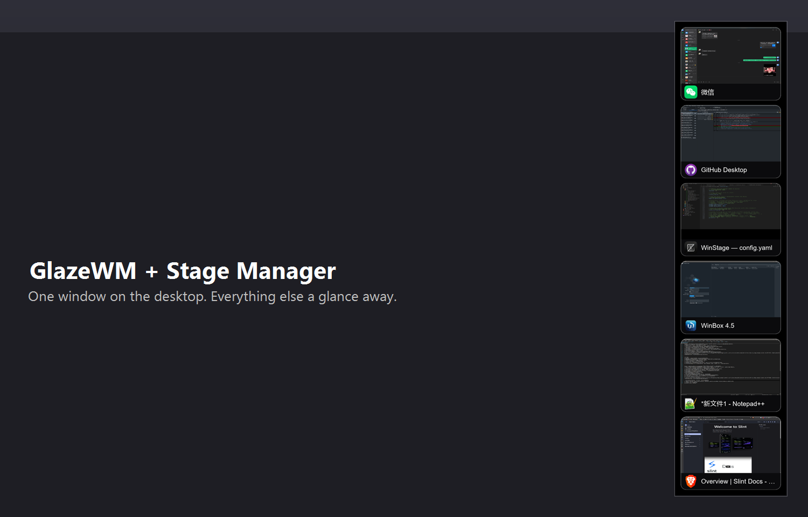

<div align="center">


# GlazeWM — Stage Manager Edition

**A fork of [GlazeWM](https://github.com/glzr-io/glazewm) v3.10.1 that adds a macOS-style
Stage Manager (single-window) mode to Windows 11 — while keeping every upstream tiling
feature exactly as it was.**

[English](#english) · [中文](#中文说明)



</div>

---

<a id="english"></a>

## What is Stage Manager?

Stage Manager is an optional, opt-in mode that turns your desktop into a
one-window-at-a-time workspace, inspired by macOS Stage Manager:

- **One window on the desktop.** When stage mode is on and another window takes
  focus (Alt+Tab, launching an app, clicking a card…), the window that *was* in
  the foreground is minimized. At most one application window stays visible.
- **Butter-smooth handoff.** The outgoing window is minimized *before* the
  incoming one is restored, and a foreground-reclaim guard re-asserts the switch
  if a just-minimized app steals the foreground back — so you almost never see
  two windows on the desktop at the same time.
- **A card dock on the side.** A floating panel docked to the left or right edge
  lists every *minimized* taskbar window (the focused window is never shown).
  Each card shows a live thumbnail — captured from the real window content just
  before it was minimized — with a clean app-icon fallback when no thumbnail is
  available yet.
- **Click a card to switch.** The clicked window is restored and focused; the
  window you were using is minimized first and appears as a new card.
- **One hotkey to turn it on/off.** The toggle command is fully bindable, or
  drivable from the CLI: `glazewm command toggle-stage-manager`.
- **Never steals focus.** The panel is a non-activating tool window: no taskbar
  button, excluded from Alt+Tab, click-through friendly.
- **Smart exemptions.** Windows that share the focused window's process or
  title, fullscreen windows, and any whitelisted window are never minimized by
  the sweep (they may coexist visibly; once minimized they appear as cards
  like everything else).

When stage mode is off, GlazeWM behaves exactly like upstream.

## Quick start

1. **Get the binary.** Build from source (see [Build](#build-from-source)) or use
   a prebuilt `glazewm.exe` from this fork's releases.
2. **Install.** Close GlazeWM (`glazewm command wm-exit`), back up the original,
   then replace the main executable (the CLI and watcher from the official
   install keep working — the IPC protocol is unchanged):

   ```powershell
   Stop-Process -Name glazewm -Force
   Copy-Item 'C:\Program Files\glzr.io\GlazeWM\glazewm.exe' 'C:\Program Files\glzr.io\GlazeWM\glazewm.exe.bak'
   Copy-Item .\glazewm.exe 'C:\Program Files\glzr.io\GlazeWM\glazewm.exe' -Force
   Start-Process 'C:\Program Files\glzr.io\GlazeWM\glazewm.exe'
   ```

3. **Configure.** Edit `~\.glzr\glazewm\config.yaml`:

   ```yaml
   keybindings:
     - context: wm
       bind: alt + shift + m
       command: toggle-stage-manager

   stage_manager:
     enabled: true   # start in stage mode on launch; omit/false = start off
     side: right     # panel dock side: left | right
     size: medium    # panel scale: small | medium | large
   ```

4. Reload the config (`glazewm command wm-reload-config`) and press
   `alt + shift + m`.

## Configuration reference

All stage-manager options live under a new `stage_manager` block in the normal
GlazeWM config file. Every field is optional — defaults are shown.

| Key                  | Values                              | Default  | Description                                                        |
| -------------------- | ----------------------------------- | -------- | ------------------------------------------------------------------ |
| `enabled`            | `true` / `false`                    | `false`  | Automatically start in stage mode when GlazeWM starts.             |
| `side`               | `left` / `right`                    | `right`  | Which edge of the primary monitor the card panel docks to.         |
| `size`               | `small` / `medium` / `large`        | `medium` | Panel scale (card width 160 / 216 / 280 px). Cards auto-shrink if the panel would overflow the screen height. |
| `opacity`            | `0.0` – `1.0`                       | `0.85`   | Card background opacity.                                           |
| `spacing`            | pixels                              | `10`     | Vertical spacing between cards.                                    |
| `corner_radius`      | pixels                              | `12`     | Card corner radius.                                                |
| `hide_on_fullscreen` | `true` / `false`                    | `true`   | Hide the panel while a fullscreen window has focus.                |
| `exempt_same_process`| `true` / `false`                    | `true`   | Never minimize windows from the focused window's process.          |
| `exempt_same_title`  | `true` / `false`                    | `true`   | Never minimize windows with the focused window's title.            |
| `exempt_fullscreen`  | `true` / `false`                    | `true`   | Never minimize fullscreen windows.                                 |
| `whitelist`          | list of match rules                 | `[]`     | Windows matching any rule are never minimized. Same matchers as `window_rules`. |

Whitelist example:

```yaml
stage_manager:
  whitelist:
    - window_process: { equals = "obs64" }
    - window_title: { regex = "Task Manager" }
    - window_class: { includes = "Chrome_WidgetWin" }
```

Behavior notes:

- Turning stage mode **off** stops the sweep but does not restore windows that
  were already minimized — that is by design, so the toggle never surprises you
  by throwing old windows back onto the desktop.
- Coexisting (exempt) windows such as extra Explorer windows stay visible
  alongside the focused one; they appear on the panel only after they get
  minimized.

## How it works

- Everything lives in a self-contained module:
  [`packages/wm/src/stage_manager/`](./packages/wm/src/stage_manager). The panel
  is a [Slint](https://slint.dev) UI (femtovg renderer) running on a dedicated
  thread inside the WM process; WM and panel exchange messages over an
  in-process channel — no extra IPC surface.
- Thumbnails are captured with `PrintWindow` from the real window *before* it is
  minimized, so cards show true content; windows with no cached capture fall
  back to a large app icon on a dark card.
- Only a handful of lines hook into upstream event paths (window managed /
  manually focused / minimize-ended, config reload, command routing). Each hook
  is a no-op unless stage mode is active, so upstream behavior is untouched.
  Full design notes: [docs/STAGE_MANAGER_DESIGN.md](./docs/STAGE_MANAGER_DESIGN.md).

## Known limitations

- Windows 11 only (the panel and the sweep use Win11-era APIs; the mode is
  simply not offered elsewhere). Multi-monitor: stage manager manages the
  **primary monitor only**.
- Thumbnails are snapshots taken at minimize time. A window that was already
  minimized *before GlazeWM started* shows the icon fallback until it is
  restored and minimized by stage mode once.
- DWM-cloaked phantom windows (UWP placeholders, some tray windows) are filtered
  out of the card list, same as the taskbar does.

## Build from source

Prerequisites: the Rust nightly toolchain (pinned by the repo's `rust-toolchain.toml`; rustup installs it automatically) and the Windows 11 SDK.

```powershell
git clone https://github.com/Vossk123/glazewm.git
cd glazewm
git checkout stage-manager
cargo build --release -p wm        # output: target\release\glazewm.exe
```

Set `VERSION_NUMBER` at build time to stamp the version
(`$env:VERSION_NUMBER="3.10.1"; cargo build --release -p wm`).

## About this fork

This fork is an **independently maintained open-source project**, born from a
personal itch: a Stage Manager workflow on Windows 11. It will stay that way —
there are no plans to merge it back upstream, and no pull requests will be
submitted to [glzr-io/glazewm](https://github.com/glzr-io/glazewm). Nothing
here should be read as an official or endorsed extension of GlazeWM.

Upstream remains the home of the core tiling window manager, and that is by
design: this fork deliberately touches as little of it as possible, so staying
independent costs very little. Issues and feature requests about stage mode are
very welcome in this repository; anything concerning core GlazeWM belongs
upstream.

## License

GPL-3.0 — same license as upstream [GlazeWM](https://github.com/glzr-io/glazewm),
copyright of the original work belongs to its authors. This fork adds the
stage-manager module and a few integration hooks on top of upstream v3.10.1.

---

<a id="中文说明"></a>

## 中文说明

本仓库是 [GlazeWM](https://github.com/glzr-io/glazewm)（Windows 平铺式窗口管理器）
v3.10.1 的 fork，为其新增了一个类 macOS **台前调度（Stage Manager）** 的单窗口模式，
仅面向 Windows 11。上游的全部平铺功能保持原样，新功能完全可选、默认关闭。

### 功能特性

- **桌面只保留一个窗口。** 开启台前调度后，当其他窗口获得焦点（Alt+Tab、新程序启动、
  点击卡片等），原本在前台的窗口会自动最小化，桌面同一时刻只有一个应用窗口可见。
- **切换丝滑。** 离场窗口先最小化、目标窗口后显示，并有"前台夺回守卫"——刚被最小化的
  程序若抢回前台会被立即纠正，尽量避免两个窗口同时出现在桌面。
- **侧边卡片面板。** 停靠于屏幕左/右缘的悬浮面板列出所有**已最小化**的任务栏窗口
  （当前焦点窗口永远不显示）。卡片缩略图取自窗口最小化前的真实画面；暂无缩略图时
  回退为应用图标卡片。
- **点卡片即切换。** 点击卡片：目标窗口恢复并获焦，你正在用的窗口先最小化并生成新卡片。
- **一个快捷键开关。** 开关命令可任意绑定键位，也可用 CLI：
  `glazewm command toggle-stage-manager`。
- **面板不抢焦点。** 无任务栏按钮、不进入 Alt+Tab、不激活不抢焦点。
- **智能豁免。** 与焦点窗口同进程 / 同标题 / 全屏的窗口以及白名单窗口永不被最小化
  （可以共存显示；一旦最小化即照常出现在卡片面板上）。

关闭台前调度后，GlazeWM 行为与上游完全一致。

### 快速开始

1. 获取二进制：自行构建（见下方），或使用 release 页面提供的 `glazewm.exe`。
2. 安装：先 `glazewm command wm-exit` 退出，备份原程序，再覆盖主程序
   （官方安装的 CLI 与 watcher 可继续保留，IPC 协议未改动）：

   ```powershell
   Stop-Process -Name glazewm -Force
   Copy-Item 'C:\Program Files\glzr.io\GlazeWM\glazewm.exe' 'C:\Program Files\glzr.io\GlazeWM\glazewm.exe.bak'
   Copy-Item .\glazewm.exe 'C:\Program Files\glzr.io\GlazeWM\glazewm.exe' -Force
   Start-Process 'C:\Program Files\glzr.io\GlazeWM\glazewm.exe'
   ```

3. 配置 `~\.glzr\glazewm\config.yaml`：

   ```yaml
   keybindings:
     - context: wm
       bind: alt + shift + m
       command: toggle-stage-manager

   stage_manager:
     enabled: true   # 启动 GlazeWM 时自动进入台前调度；不写/false = 默认关闭
     side: right     # 面板停靠侧: left | right
     size: medium    # 面板大小: small | medium | large
   ```

4. `glazewm command wm-reload-config` 重载配置，按 `alt + shift + m` 开关。

### 配置项一览

所有新参数都在配置文件的 `stage_manager` 段，均可省略（下表为默认值）：

| 参数                 | 取值                                | 默认值   | 说明                                                       |
| -------------------- | ----------------------------------- | -------- | ---------------------------------------------------------- |
| `enabled`            | `true` / `false`                    | `false`  | GlazeWM 启动时自动开启台前调度。                           |
| `side`               | `left` / `right`                    | `right`  | 面板停靠的主显示器边缘。                                   |
| `size`               | `small` / `medium` / `large`        | `medium` | 面板档位（卡片宽 160 / 216 / 280 px）；放不下时卡片自动收窄。 |
| `opacity`            | `0.0` – `1.0`                       | `0.85`   | 卡片背景不透明度。                                         |
| `spacing`            | 像素                                | `10`     | 卡片纵向间距。                                             |
| `corner_radius`      | 像素                                | `12`     | 卡片圆角半径。                                             |
| `hide_on_fullscreen` | `true` / `false`                    | `true`   | 焦点窗口全屏时自动隐藏面板。                               |
| `exempt_same_process`| `true` / `false`                    | `true`   | 永不最小化与焦点窗口同进程的窗口。                         |
| `exempt_same_title`  | `true` / `false`                    | `true`   | 永不最小化与焦点窗口同标题的窗口。                         |
| `exempt_fullscreen`  | `true` / `false`                    | `true`   | 永不最小化全屏窗口。                                       |
| `whitelist`          | 匹配规则列表                        | `[]`     | 命中任一规则的窗口永不被最小化（与 `window_rules` 同款匹配器）。 |

白名单示例：

```yaml
stage_manager:
  whitelist:
    - window_process: { equals = "obs64" }
    - window_title: { regex = "任务管理器" }
    - window_class: { includes = "Chrome_WidgetWin" }
```

行为说明：

- 关闭台前调度只会停止"最小化其他窗口"的规则，**不会**把已最小化的窗口自动放回桌面——
  这是刻意设计，避免关闭瞬间旧窗口砸回桌面。
- 被豁免的共存窗口（例如额外打开的资源管理器窗口）可以与焦点窗口同时显示；
  它们只有在被最小化后才会出现在卡片面板上。

### 实现要点

- 全部新代码集中在自包含模块
  [`packages/wm/src/stage_manager/`](./packages/wm/src/stage_manager)：面板是基于
  [Slint](https://slint.dev)（femtovg 渲染器）的 UI，运行在 WM 进程内的独立线程，
  两者通过进程内通道通信，不引入任何新的 IPC 面。
- 缩略图在窗口最小化**之前**用 `PrintWindow` 抓取真实画面，卡片显示真实内容；
  无缓存时回退为深色底大图标。
- 对上游事件路径仅加了极少量挂接点（窗口托管 / 手动聚焦 / 最小化结束、配置重载、
  命令路由），每个挂接点在台前调度关闭时都是空操作，上游行为零改动。
  完整设计文档：[docs/STAGE_MANAGER_DESIGN.md](./docs/STAGE_MANAGER_DESIGN.md)。

### 已知限制

- 仅支持 Windows 11；多显示器场景只管理**主显示器**。
- 缩略图是"最小化瞬间"的快照。在 GlazeWM 启动前就已最小化的窗口会先显示图标卡片，
  直到它被台前调度完整经历一次"恢复→最小化"。
- 与任务栏一致地过滤 DWM 隐身幽灵窗口（UWP 占位窗等）。

### 从源码构建

前置：Rust nightly 工具链（由仓库的 `rust-toolchain.toml` 固定，rustup 会自动安装）+ Windows 11 SDK。

```powershell
git clone https://github.com/Vossk123/glazewm.git
cd glazewm
git checkout stage-manager
cargo build --release -p wm        # 产物: target\release\glazewm.exe
```

构建时设置 `VERSION_NUMBER` 可写入版本号
（`$env:VERSION_NUMBER="3.10.1"; cargo build --release -p wm`）。

### 关于本 fork

本仓库是一个**独立维护的开源项目**：做"台前调度"只是想满足自己的使用习惯，并
不打算把改动合并回上游——不会向 [glzr-io/glazewm](https://github.com/glzr-io/glazewm)
提交 PR，也请勿把它当作 GlazeWM 的官方或受背书延伸。

这正是刻意保持"最小侵入"的好处：核心平铺功能永远以上游为准，本 fork 独立演进
的维护成本极低。台前调度相关的问题与建议，欢迎在本仓库提出；GlazeWM 核心本身
的问题，请移步上游仓库。

### 许可证

GPL-3.0，与上游 [GlazeWM](https://github.com/glzr-io/glazewm) 一致；原始作品的
版权归其作者所有。本 fork 在上游 v3.10.1 之上添加了 stage_manager 模块与少量挂接点。
